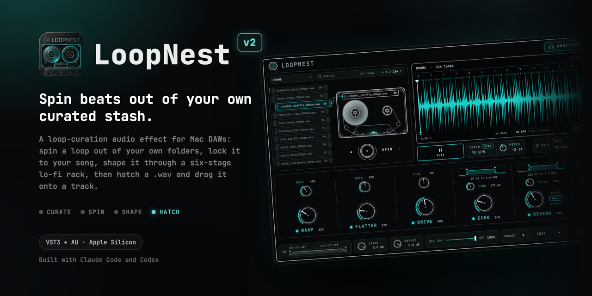
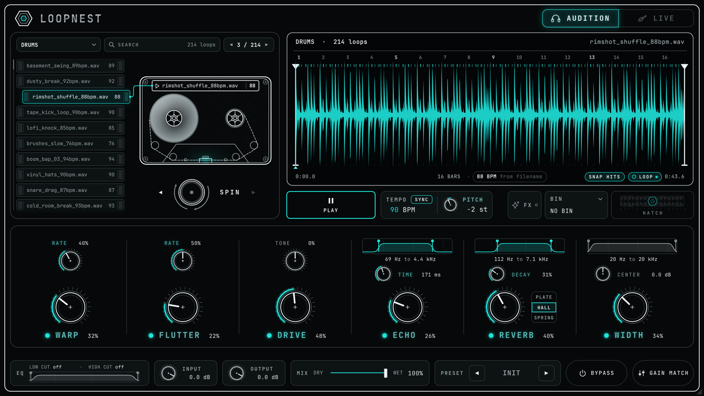

<p align="center">
  
</p>

<p align="center">
  
  
  
  
  
  
</p>

---

LoopNest is a **VST3 + AU** audio effect for Mac DAWs (Ableton, Logic, Reaper,
Bitwig, and friends). It turns a folder of loops you love into a beat-making
slot machine.

The loop is: **curate → spin → shape → hatch**. Point it at a folder of loops,
hit spin, and it pulls one out at random. Trim it, pitch it, dirty it up through
a six-stage lo-fi rack until it sounds like *yours*, then **hatch** a `.wav` and
drag it straight onto a track.

## What's new in v2

Version 2 is a rebuild of 1.0. LoopNest now sits on a track as an audio effect,
locks to your song's tempo and bar grid, and can run the track's own audio
through the rack.

- **Sync**: follows your DAW's tempo with the pitch held.
- **Free tempo**: drag the tempo and the loop plays at a tempo of its own.
- **Bar-grid lock**: with SYNC and LOOP on, the loop runs on the song's bar grid
  and starts and stops with the DAW's transport.
- **Audition and Live**: AUDITION plays the spun loop. LIVE runs the track's own
  audio through the rack.
- **Drag in**: drop audio from Finder, Splice or Live onto the tape rack to add it
  to your loop folder.
- **Print bins**: hatch into subfolders of `~/Music/LoopNest/Prints/`.
- **Back and forward**: ◀ ▶ step through your spins and bring back the whole sound.
- **Reverb types**: PLATE, HALL or SPRING.



## The basics

- **Spin**: the big rotor pulls a random loop from your folder. Spin as much as
  you want.
- **Shape**: pitch, trim, and a six-knob rack: warp · flutter · drive · echo ·
  reverb · width. Every knob is clean at zero.
- **Focus**: give each effect its own slice of the spectrum, plus a master EQ and
  a dry/wet mix.
- **Presets**: 11 factory looks that only touch the rack.
- **A/B**: flip to the untouched loop, level-matched.
- **Hatch**: bounce the loop to a `.wav` and drag it onto a track. Dry by default;
  switch on FX to print what you hear.
- **Curate**: point the funnel at a sample library and it pulls just the full
  drum grooves into a folder.

## Install

Download the zip from [Releases](https://github.com/andrewmfoster/LoopNest/releases)
and follow `INSTALL.txt` inside. Needs macOS 13 or later on Apple Silicon. It isn't
notarized, so INSTALL.txt has the one command that lets macOS load it.

Version 2 replaces version 1. Sets made with version 1 open with LoopNest missing;
1.0 is still on the releases page for those.

## Build from source

```bash
git clone --recurse-submodules https://github.com/andrewmfoster/LoopNest.git
cd LoopNest
cmake -S . -B build -DCMAKE_BUILD_TYPE=Release
cmake --build build --config Release
```

Builds both a VST3 and an AU. The AU needs full Xcode, not just the command-line
tools.

## License

Source code: [MIT](LICENSE). The plugin binaries are built with JUCE under the
AGPLv3, so the VST3 and AU ship under the [AGPLv3](AGPL-3.0.txt). Third-party
notices: [THIRD-PARTY-NOTICES.txt](THIRD-PARTY-NOTICES.txt). JetBrains Mono:
[SIL OFL](fonts/OFL.txt). © 2026 Andrew Foster.
